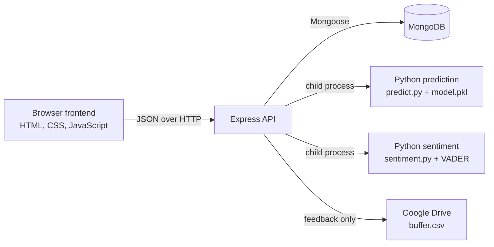

# MindScope

MindScope is a web application for research scholars to record structured well-being check-ins and review their recent results. It combines a static browser interface with an Express/MongoDB API, a checked-in Python model that derives a 0-100 well-being score, and VADER sentiment analysis of optional reflection notes.

The project is a working application rather than a packaged release: the frontend, backend, model artifact, and a GitHub Pages deployment workflow are present, but there is no automated test suite or root license file.

## Features

- Email/password account creation or sign-in with seven-day JWT sessions.
- A three-sheet scholar check-in covering study profile, workload, support, functioning, and optional reflection notes.
- Server-side persistence of the latest check-in, score history, up to five checkpoint dates, preferences, and a session streak in MongoDB.
- Random-forest-based predictions for PSS, GAD-7, and PHQ-9 scores, normalized into an overall well-being score.
- VADER sentiment analysis for reflection text, with a small keyword-based fallback if Python sentiment analysis is unavailable.
- A profile dashboard with the five most recent well-being points, current state-of-mind label, and saved preferences.
- A browser-stored insight view with contributing-factor display and a local score estimate if the prediction endpoint is unavailable.
- Optional authenticated feedback submission to a CSV file in Google Drive.
- Light/dark themes, page transitions, and the included visual/animation assets.

## Architecture



The static frontend calls `http://127.0.0.1:3000/api` when opened from a local host or `file:` URL. On other hosts it is configured in `FrontEnd/assets/app.js` to call a hosted API. Authentication and check-in submission use the API; the frontend also caches the authenticated user, latest responses, insight, and theme in browser `localStorage`.

## Technology stack

| Area | Implementation |
| --- | --- |
| Frontend | HTML, CSS, vanilla JavaScript |
| API | Node.js, Express 5, CORS, Helmet, dotenv |
| Identity and data | JWT, bcryptjs, MongoDB, Mongoose |
| ML and analysis | Python, pandas, scikit-learn, joblib, VADER Sentiment |
| Feedback storage | Google Drive API (`googleapis`) |
| Static-site publishing | GitHub Actions and `peaceiris/actions-gh-pages` |

## Project structure

```text
.
|-- FrontEnd/
|   |-- index.html              # Landing page
|   |-- login.html              # Sign-in/account creation screen
|   |-- form.html               # Three-step scholar check-in
|   |-- profile.html            # Progress dashboard and preferences
|   |-- ml-insight.html         # Latest score, factors, and feedback
|   `-- assets/
|       |-- app.js              # Browser behavior and API client
|       |-- styles.css
|       `-- images/             # Illustrations and form animation frames
|-- BackEnd/
|   |-- server.js               # Express startup and route registration
|   |-- controllers/authController.js
|   |-- config/                 # MongoDB, user model, Google Drive client
|   |-- routes/                 # Auth, prediction, sentiment, feedback routes
|   `-- ML/
|       |-- model.pkl           # Model used by the prediction endpoint
|       |-- predict.py
|       |-- sentiment.py
|       |-- Train.py            # Retraining script; requires an external XLSX dataset
|       `-- requirements.txt
`-- .github/workflows/deploy.yml # Publishes FrontEnd/ on pushes to master
```

## Prerequisites

- Node.js and npm (no runtime version is declared in the repository).
- Python 3 available as `python` on Windows or `python3` elsewhere. Set `PYTHON` if a different executable must be used.
- A reachable MongoDB instance.
- Google Drive service-account access only when using the feedback feature.

## Installation and configuration

Install the Node and Python dependencies from their respective project folders:

```powershell
cd BackEnd
npm ci

cd ML
python -m pip install -r requirements.txt
cd ..
```

Create `BackEnd/.env`. The server refuses to start unless `MONGO_URI` and `JWT_SECRET` are set.

```dotenv
# Required
MONGO_URI=<mongodb-connection-string>
JWT_SECRET=<long-random-secret>

# Optional: defaults to 3000
PORT=3000

# Optional: Python executable used by prediction and sentiment subprocesses
PYTHON=python

# Required only for POST /api/buffer/feedback
GOOGLE_SERVICE_ACCOUNT_EMAIL=<service-account-email>
GOOGLE_SERVICE_ACCOUNT_PRIVATE_KEY=<private-key-with-escaped-newlines>

# Select one of these target-file options for feedback storage
GOOGLE_DRIVE_BUFFER_FILE_ID=<google-drive-file-id>
# GOOGLE_DRIVE_BUFFER_FILE_NAME=buffer.csv
```

`GOOGLE_DRIVE_BUFFER_FILE_ID` takes precedence. If it is absent, the API looks in the service account's accessible Drive files for `GOOGLE_DRIVE_BUFFER_FILE_NAME`, which defaults to `buffer.csv`. The service account must be able to read and update that CSV. Environment files are ignored by Git and should never be committed.

## Run locally

Start the API from `BackEnd`:

```powershell
npm start
```

It connects to MongoDB before listening, and uses port `3000` unless `PORT` is set. The root route returns `Hello World!`; application routes are mounted under `/api`.

In a second terminal, serve `FrontEnd` as a static site on port `5500`:

```powershell
cd FrontEnd
python -m http.server 5500
```

Open `http://127.0.0.1:5500` in the browser. This address is explicitly allowed by the API CORS configuration and selects the local API URL. `localhost:5500` is also allowed. The frontend has no npm build step.

## Usage

1. Open the local frontend and sign in. The `/api/auth/authenticate` endpoint creates an account if the email does not already exist; existing accounts must provide the matching password.
2. Complete all required fields across the three check-in sheets and submit. The API runs the well-being prediction and sentiment analysis, then stores the resulting data on the user record.
3. Review the calculated score and state-of-mind label in **ML Insight**, then optionally accept the score or submit a manual one as feedback. Feedback requires the Google Drive configuration above.
4. Use **Profile** to view recent data, restore the previous check-in into the form, and save the check-in frequency/email-reminder preferences.

## API overview

All protected endpoints expect `Authorization: Bearer <JWT>`.

| Route | Purpose |
| --- | --- |
| `POST /api/auth/register` | Create an account. |
| `POST /api/auth/login` | Sign in to an existing account. |
| `POST /api/auth/authenticate` | Sign in if the account exists, otherwise create it. |
| `GET /api/auth/me` | Retrieve the authenticated user profile. |
| `POST /api/auth/check-in` | Score and persist a named check-in. |
| `POST` / `GET /api/auth/latest-check-in` | Save or restore the latest check-in payload. |
| `PUT /api/auth/preferences` | Update check-in frequency and email-reminder preference. |
| `POST /api/predict` | Run the Python model for a feature payload. |
| `POST /api/sentiment` | Return sentiment scores for `{ "text": "..." }`. |
| `POST /api/buffer/feedback` | Append a feedback record to the configured Drive CSV. |

The model requires these numeric features: `degree_level`, `study_mode`, `funding_status`, `program_year`, `weekly_hours`, `supervisor_freq`, `caregiving`, `productivity_index`, `coping_index`, and `stressor_index`.

## Model training

The repository includes `BackEnd/ML/model.pkl`, which is the artifact used at runtime. `Train.py` can regenerate it from `AI_Scholar_Survey_Dataset.xlsx` in the same `ML` directory:

```powershell
cd BackEnd\ML
python Train.py
```

That workbook is not tracked (all `.xlsx` files are ignored), so retraining cannot be reproduced from this repository alone. The script expects the ten input fields above plus `pss_score`, `gad7_score`, and `phq9_score` columns.

## Deployment

`.github/workflows/deploy.yml` publishes `FrontEnd/` to GitHub Pages whenever `master` is pushed. It does not build or deploy the Node/Python API. A deployed frontend therefore depends on an accessible API; the current browser code contains a hard-coded non-local API base URL. Confirm that endpoint and its CORS policy before relying on the Pages deployment.

## Testing and verification

`BackEnd/package.json` has no test suite - the `test` script exits with an error - and no Python tests are included. JavaScript syntax was checked during this README update with `node --check` for the server, backend modules, and frontend script. The application was not started because doing so requires MongoDB and environment credentials.

## Security and privacy considerations

- Passwords are hashed with bcrypt before the user document is saved, and protected API routes verify a JWT.
- Check-in responses and derived well-being data are stored in MongoDB; feedback can additionally be written to Google Drive.
- The browser stores the JWT and recent check-in/insight data in `localStorage`. Consider the privacy implications on shared devices.
- The server's CORS allowlist is fixed in `BackEnd/server.js`; update it deliberately when hosting the frontend elsewhere.

## Limitations

- No automated tests, API specification, or root license file are present.
- `npm run dev` invokes `nodemon`, but `nodemon` is not declared in `package.json`; use `npm start` unless it is installed separately.
- The score history and visible checkpoint timeline are capped at five entries; the streak increments on every submitted check-in rather than being validated against calendar continuity.
- Browser-side local estimates are used when prediction requests fail, so they are not model output.
- The preference named "Email reminder" is stored, but this repository contains no email delivery implementation.
- The feedback CSV operation rewrites the file after downloading it; concurrent submissions may need additional coordination.

## Contributing

There is no repository-specific contribution guide. Keep changes focused, avoid committing `.env` files or datasets, install dependencies in `BackEnd`, and run the available syntax/test checks relevant to your change before opening a contribution.

## Repository

The Git remote identifies the project repository as [UditDiwani/MindScope](https://github.com/UditDiwani/MindScope).
